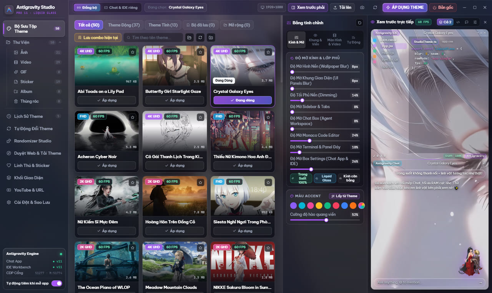

<div align="center">

# ✨ Antigravity Studio

**Clear Optical Liquid Glass & 60FPS Live Video Customizer cho Google Antigravity IDE & Chat App**

[](https://github.com/mqinpuienhzg/antigravity-studio/releases)
[](https://github.com/mqinpuienhzg/antigravity-studio)
[](LICENSE)
[](https://github.com/mqinpuienhzg)

*Không chỉnh sửa file nhị phân gốc của IDE • Trong suốt 0px không vệt nối • Siêu nhẹ RAM • Tự giữ theme sau khi tắt/mở máy*

</div>

---

## 📸 Hình Ảnh Thực Tế (Live Screenshots)

### 💎 Antigravity IDE — Clear Liquid Glass & Linh Vật Tương Tác


### 🎛️ Antigravity Studio — Bảng Điều Khiển & Xem Trước Chia Đôi Cạnh Phải


---

## 🌟 Tính Năng Nổi Bật (Key Features)

- **💎 Clear Optical Liquid Glass (Kính Pha Lê Trong Suốt — Không Đục Trắng):**
  - Toàn bộ nút bấm, tab file, thanh nhập Chat, bảng Cài đặt dùng hiệu ứng kính quang học trong suốt nhìn xuyên thẳng xuống video nền 60FPS với viền phản xạ ánh sáng sắc nét.
  - Ẩn hoàn toàn thanh mờ Titlebar, Statusbar và vệt tối mép Chat khi chọn độ mờ `0%`.
- **🎬 Kiến Trúc 1 Video Xuyên Suốt + Eco Single-Deck (Tiết Kiệm 50% RAM/VRAM):**
  - IDE và Chat dùng chung **1 luồng video duy nhất**, phóng to/thu nhỏ/zoom (`Ctrl+`/`Ctrl-`) **luôn khớp tuyệt đối 0px**.
  - Tự động thu gom bộ nhớ **Blob GC (`URL.revokeObjectURL`)** khi đổi theme và dùng **Poster Thumbnail tĩnh** cho lưới gallery — giảm hơn **800 MB Private RAM** so với render video hàng loạt.
  - Chuyển 1 chạm giữa chế độ **Đồng bộ toàn màn hình** và **Chat & IDE riêng biệt**.
- **🪟 Trong Suốt 3 Lớp Cho MỌI Màn Hình IDE:**
  - Bao phủ liền mạch Code Editor, Chat Workspace, **Antigravity Settings** (Account, General, Appearance, Models, Browser), VS Code Settings, Extensions, **Terminal (`xterm.js`)**, Notification Toasts và Webview.
- **🖥️ Xem Trước Trực Tiếp Chia Đôi Cạnh Phải (`Xem trước phải`):**
  - Xem đồng thời **Antigravity IDE (trên)** + **Antigravity Chat & Linh vật tương tác (dưới)** ngay trong Studio theo thời gian thực khi rê chuột hoặc kéo thanh trượt.
- **🦋 Linh Vật Tương Tác Tự Nhiên Như Người Thật:**
  - Dõi theo hướng con trỏ chuột khi rê qua, **xoa đầu** (click vùng đầu) sẽ nghiêng đầu ửng má dịu dàng, click thân xoay vòng 8 phản ứng tự nhiên không trùng lặp, click vùng dưới sẽ né lùi trêu ghẹo, nháy đúp kích hoạt màn xoay 3D Encore.
  - **Kéo thả tự do khắp màn hình** có độ nghiêng quán tính & đáp mềm, tự lưu vị trí vĩnh viễn.
- **🎨 29+ Video Live HD Tuyển Chọn & Kho Mở Rộng Vô Hạn:**
  - Kèm sẵn 29 video live HD tối ưu dung lượng, 8 ảnh nền 2K, 13 linh vật và trình duyệt tích hợp tải trực tiếp từ **MoeWalls, MotionBGs, Pixabay, Pexels, Wallhaven, Tenor, Giphy**.
  - Hỗ trợ thả thêm `.mp4 / .webm / .gif / .jpg / .png` vào thư mục `Themes/` cạnh file `.exe`.
- **⚡ Tự Động Tiêm Tức Thì Khi Mở Máy (`argv.json` + System Tray):**
  - Tự đăng ký cờ CDP an toàn trong `~/.antigravity-ide/argv.json`, chạy ngầm dưới khay hệ thống (click đơn icon khay hệ thống hoặc mở lại `.exe` để bật ngay cửa sổ lên trên cùng).

---

## 🚀 Hướng Dẫn Cài Đặt & Sử Dụng Nhanh

### Cách 1: Tải Bản Portable Chạy Ngay (Khuyên Dùng)
1. Tải file **`Antigravity-Studio-Portable.exe`** trong mục [Releases](https://github.com/mqinpuienhzg/antigravity-studio/releases).
2. Đặt vào một thư mục cố định (ví dụ `D:\AntigravityStudio\`) và nhấp đúp mở.
3. Nhấn nút **Khởi động lại IDE** (hoặc **ÁP DỤNG THEME**) ở thanh trên cùng — Studio sẽ tự cấu hình CDP vĩnh viễn và phủ giao diện ngay lập tức.

### Cách 2: Tự Build Từ Mã Nguồn (Developers)

**Yêu cầu:** Windows 10/11 (x64), Node.js 18+ (khuyên dùng Node 20/22+).

```bash
# 1. Clone repository
git clone https://github.com/mqinpuienhzg/antigravity-studio.git
cd antigravity-studio

# 2. Cài đặt thư viện
npm install

# 3. Chạy thử chế độ phát triển (Vite + Electron)
npm run dev

# 4. Build UI & đóng gói file Portable (.exe)
npm run build:ui
npm run dist
```

*(Tùy chọn)* Để bật tính năng tải video từ YouTube trực tiếp trong app khi tự build, tải `yt-dlp.exe` từ [yt-dlp Releases](https://github.com/yt-dlp/yt-dlp/releases/latest) và đặt vào thư mục `bin/yt-dlp.exe`.

File `.exe` đóng gói sẽ xuất tại `release/Antigravity-Studio-Portable.exe`.

---

## 📁 Cấu Trúc Mã Nguồn

```text
antigravity-studio/
├── assets/
│   ├── videos/          # 29 video live HD đã tối ưu dung lượng siêu gọn
│   ├── thumbs/          # 29 ảnh poster JPEG siêu nhẹ (~630 KB) cho Gallery 0-video-idle
│   ├── wallpapers/      # 8 hình nền tĩnh 2K sắc nét
│   ├── mascots/         # 13 linh vật tương tác trong suốt
│   └── brand/           # Logo & biểu tượng ứng dụng
├── electron/
│   ├── main.cjs         # Electron main process, Tray, Window reveal, Startup, IPC
│   ├── cdp-bridge.cjs   # Cầu nối CDP live (fs.watch + Browser Target Push)
│   ├── injector-payload.cjs # Engine Liquid Glass, 1-Video Pass-Through, Blob GC & Mascot Physics
│   ├── store.cjs        # Lưu cấu hình an toàn (.tmp + .bak), Combos, History, Trash
│   ├── media-server.cjs # HTTP Media Server cục bộ (127.0.0.1)
│   ├── online-downloader.cjs # Bộ tải video online (YouTube/Direct URL)
│   └── preload.cjs      # ContextBridge IPC
├── src/
│   ├── App.jsx          # Bố cục chính Clear Liquid Glass Studio
│   ├── components/      # TopBar, Sidebar, ThemeGallery, SideSplitPreview, RightControls...
│   └── styles/app.css   # Hệ thống giao diện quang học Clear Liquid Glass
├── docs/screenshots/    # Ảnh minh họa giao diện thực tế
├── scripts/afterPack.cjs # Tối ưu gói build (cắt 53 locale thừa, giảm ~40 MB)
└── package.json
```

---

## 🔒 An Toàn & Hoàn Tác 1 Chạm

- **Không bao giờ sửa đổi file nhị phân (`.exe` / `app.asar`) của Antigravity IDE.**
- Toàn bộ hiệu ứng hoạt động động qua Chrome DevTools Protocol (CDP) nội bộ trên `127.0.0.1`.
- Nhấn nút **Bản gốc** bất cứ lúc nào để gỡ sạch 100% tùy biến và trả IDE về mặc định.

---

## 👤 Tác Giả & Giấy Phép

- Phát triển bởi **[mqinpuienhzg](https://github.com/mqinpuienhzg)**
- Giấy phép mã nguồn mở: [MIT License](LICENSE)

Nếu thấy công cụ hữu ích, đừng quên tặng một **⭐ Star** cho dự án nhé!
