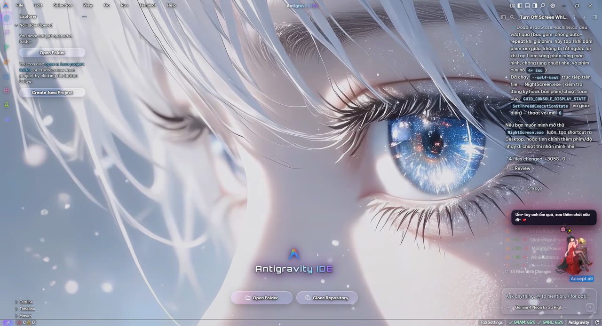

<div align="center">

# 🦀✨ Antigravity Studio Rust

**Clear Optical Liquid Glass & 60FPS Live Video Customizer cho Google Antigravity IDE & Chat — Viết lại bằng Rust + Tauri v2**

[](https://github.com/mqinpuienhzg/antigravity-studio/releases)
[](https://tauri.app/)
[](https://github.com/mqinpuienhzg/antigravity-studio)
[](LICENSE)
[](https://github.com/mqinpuienhzg)

*File chạy native chỉ **6.62 MB** • Chạy nền System Tray chỉ **8.1 MB Private RAM** • Không chỉnh sửa file gốc của IDE • Kèm sẵn 29 video live HD*

</div>

---

## 📊 So Sánh Thực Tế: Bản Rust (`v12.0.0`) vs Bản Electron Cũ (`v11.2.3`)

| Hạng mục (đo thực tế trên Windows 10/11 x64) | Bản Electron (`v11.2.3`) | Bản Rust (`v12.0.0`) |
| :--- | :---: | :---: |
| **Dung lượng file thực thi chính** | ~280 MB (`win-unpacked`) | **`6.62 MB`** (`Antigravity Studio Rust.exe`) |
| **Gói phân phối đủ 29 video live HD** | `186 MB` (Portable) | **`73.06 MB`** (NSIS Installer / Portable ZIP) |
| **RAM chạy nền (System Tray + đang gắn CDP)** | `812.34 MB` Private (`568.88 MB` WS) | **`8.10 MB` Private** (`15.85 MB` WS — nhẹ hơn **100×**) |
| **Mở lại cửa sổ UI từ khay hệ thống** | ~0.88 giây | **`0.18 giây`** |

---

## 📸 Hình Ảnh Thực Tế (Live Screenshots)

### 💎 Antigravity IDE — Clear Liquid Glass & Linh Vật Tương Tác


### 🎛️ Antigravity Studio — Bảng Điều Khiển & Xem Trước Chia Đôi Cạnh Phải


---

## 🌟 Tính Năng Nổi Bật

- **🦀 Backend 100% Native Rust (`src-tauri/src/`):**
  - **Axum 0.8 + Tokio HTTP Media Server** hỗ trợ streaming **Byte-Range (`206 Partial Content`)** cho 29 video live HD 60FPS.
  - **Tokio + `tokio-tungstenite` CDP Bridge** tự phát hiện cổng CDP của Antigravity IDE, theo dõi `DevToolsActivePort` bằng `notify`, tự phục hồi sau khởi động lạnh và đồng bộ layout IDE ↔ Chat tức thì.
  - **Kiến trúc Tray tự hủy WebView2:** Đóng cửa sổ (`X`) sẽ giải phóng toàn bộ bộ nhớ WebView2 về mức **`~8 MB` Private RAM** mà vẫn giữ nền video & tự tiêm theme; click icon khay hệ thống mở lại giao diện trong `0.18 giây`.
- **💎 Clear Optical Liquid Glass (Kính Pha Lê Trong Suốt):**
  - Nhìn xuyên thẳng xuống video nền 60FPS không bị lớp nền trắng đục, ẩn sạch thanh mờ Titlebar, Statusbar và vệt bóng dọc mép Chat ở mức `0%`.
  - Kiến trúc **1-Video Pass-Through** giữ IDE và Chat khớp tuyệt đối `0px` khi phóng to, thu nhỏ hoặc zoom.
- **🖥️ Hình Nền Động Windows Desktop Tích Hợp (`desktop_wallpaper.rs`):**
  - Đặt trực tiếp 29 video live HD 60FPS hoặc video cá nhân làm **hình nền động Windows Desktop** phía sau icon thông qua Win32 `WorkerW` (hỗ trợ Windows 10 & Windows 11).
  - Tự động **tạm nghỉ GPU (`desktopSmartPause`)** khi mở game hoặc ứng dụng toàn màn hình và tự khôi phục nền gốc Windows khi tắt.
- **🖥️ Xem Trước Trực Tiếp Cạnh Phải & Linh Vật Tương Tác:**
  - Khung xem trước chia đôi hiển thị đồng thời IDE + Chat ngay khi kéo thanh trượt.
  - 13 linh vật tương tác tự nhiên: dõi chuột, xoa đầu ửng má, phản ứng đa dạng theo vùng chạm, kéo thả mượt & tự lưu vị trí.
- **🔒 An Toàn Tuyệt Đối:**
  - Không chỉnh sửa file nhị phân gốc của Antigravity IDE; chỉ đăng ký cờ CDP an toàn trong `~/.antigravity-ide/argv.json` và hỗ trợ nút **1 chạm về Bản gốc**.

---

## 🚀 Hướng Dẫn Cài Đặt & Sử Dụng Nhanh

### Cách 1: Tải Bản Đóng Gói Chạy Ngay (Khuyên Dùng)
1. Vào mục [Releases](https://github.com/mqinpuienhzg/antigravity-studio/releases) tải **`Antigravity Studio Rust_12.0.0_x64-setup.exe`** (`73 MB`, tự cài gọn không cần quyền Admin) hoặc bản **`Antigravity-Studio-Rust-v12.0.0-Portable.zip`** giải nén chạy thẳng.
2. Mở **Antigravity Studio Rust** và nhấn **ÁP DỤNG THEME** (hoặc **Khởi động lại IDE** lần đầu để kích hoạt CDP vĩnh viễn).

### Cách 2: Tự Build Từ Mã Nguồn (Developers)

**Yêu cầu (Windows 10/11 x64):** Node.js 18+, Rust (`rustup`, target `x86_64-pc-windows-msvc`), Visual Studio C++ Build Tools (Desktop development with C++), và Microsoft Edge WebView2 Runtime (có sẵn trên Windows 10/11).

```powershell
# 1. Clone repository
git clone https://github.com/mqinpuienhzg/antigravity-studio.git
cd antigravity-studio

# 2. Cài đặt gói giao diện & Tauri CLI
npm install

# 3. Chạy thử chế độ phát triển (Vite + Rust)
npm run dev

# 4. Build bản Release tối ưu (.exe + bộ cài NSIS)
npm run build
```

*(Tùy chọn)* Để bật tính năng tải video từ YouTube trực tiếp trong app, tải `yt-dlp.exe` từ [yt-dlp Releases](https://github.com/yt-dlp/yt-dlp/releases/latest) và đặt vào thư mục `bin/yt-dlp.exe`.

---

## 📁 Kiến Trúc Mã Nguồn

```text
├── src/                        # Giao diện React + Vite + cầu nối Tauri v2 (src/api/tauriBridge.js)
├── src-tauri/
│   ├── src/
│   │   ├── main.rs             # Điểm vào Windows GUI subsystem
│   │   ├── lib.rs              # Khởi tạo Tauri v2, System Tray siêu nhẹ, Single-Instance
│   │   ├── media_server.rs     # Axum 0.8 HTTP server hỗ trợ Byte-Range 206 + /__studio/*
│   │   ├── cdp_bridge.rs       # Tokio WebSocket CDP bridge + notify watcher + self-healing
│   │   ├── store.rs            # Quản lý 29 video, 8 ảnh 2K, 13 linh vật, combo, backup JSON
│   │   ├── ide_sync.rs         # Đồng bộ argv.json, settings.json, Windows Registry (winreg)
│   │   ├── downloader.rs       # Tải trực tiếp HTTP streaming (reqwest) & yt-dlp / ffmpeg
│   │   └── commands.rs         # 37 lệnh Tauri IPC + hộp thoại chọn file/thư mục native
│   └── resources/              # Lõi injector-runtime.js & catalog nhúng lúc biên dịch
└── assets/                     # 29 video live HD, 29 poster JPEG, 8 ảnh 2K, 13 linh vật
```

## 📄 Giấy Phép

Phát hành theo giấy phép **MIT License** — xem chi tiết tại [LICENSE](LICENSE). Phát triển bởi **[mqinpuienhzg](https://github.com/mqinpuienhzg)**.
